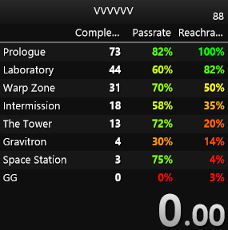

  

# LiveSplit.Splits component with more column types

## Installing
Download `LiveSplit.Splits.dll` file from releases and move it to `C:/Program Files (x86)/LiveSplit/Components` (or wherever you installed livesplit)

## Columns
- **Completed** - shows how many times the split has been completed (skipped splits count as completed)
- **Passrate** - shows completed / reached
- **Reachrate** - shows reached / total attempts

Reached counts are tracked per split, so reordering, inserting or removing splits does not break the rates.

### Coloring
For the **passrate** and **reachrate** column types, enable **Color by rate** in the column settings. Color changes from red at 0% to yellow at 50% to green at 100%.

Layouts from earlier versions keep working: setting the column timing method to Game Time also enables coloring.

### Where the counts are stored
Counts are saved in the splits file (`.lss`) as one permanent run variable named `SplitsReachStats`, keyed by split name.
- Splits files without it are recalculated from the segment history when opened, and the variable is written on the next save
- LiveSplit without this component ignores the variable; attempts made that way are added the next time the file is opened with it
- A renamed split is re-estimated from its history, and a newly added split starts at 0

## Building from source

Building has same requirements as for [LiveSplit](https://github.com/LiveSplit/LiveSplit):
- [.NET 8.0 SDK](https://dotnet.microsoft.com/en-us/download/dotnet/8.0)
- [.NET Framework 4.8.1 Developer Pack](https://dotnet.microsoft.com/en-us/download/dotnet-framework/thank-you/net481-developer-pack-offline-installer) (Which should be preinstalled at most windows installations)

1. Clone repository
2. Replace files in `/lib/` as needed
3. Run `dotnet build`
4. Get `LiveSplit.Splits.dll` from `/artifacts/bin/LiveSplit.Splits/debug/`